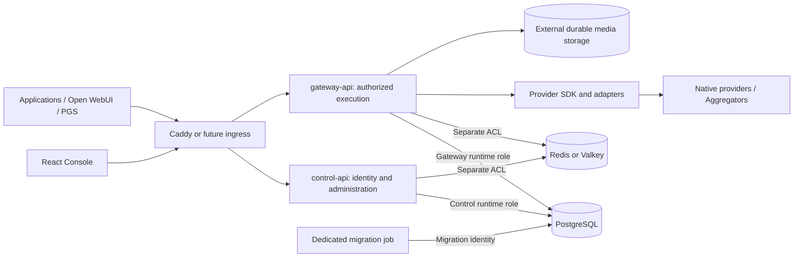

# Target architecture

Status: the two-application topology, canonical core/TypeORM ownership and portable deployment direction are accepted by the [architecture update](../prs/pr-00/pr-00-adr-update.md). The [finalization brief](../prs/pr-00/pr-00-finalize.md) preserves these decisions and splits delivery; implementation remains unverified and PR01A/PR01B unstarted. This supersedes the earlier single-process proposal; see [ADR-001](decisions/ADR-001-control-gateway-separation.md).

## Applications and trust crossings



`control-api` owns login/session lifecycle, tenant/user/membership administration, BYOK lifecycle, provider configuration, policy authoring, plans, licensing, entitlements and administrative audit. `gateway-api` owns independent request verification/authorization, route/model discovery, exact credential resolution, admission, quotas, usage, chat/SSE/multimodal execution and structured evaluation. Signing in is a Control workflow; verifying an inference caller is a Gateway responsibility. PGS and the website remain separate applications/repositories.

Provider execution belongs only in Gateway. Adapters cannot query tenant data, resolve secrets, authorize users, change entitlements or make PGS decisions. A Control action to verify a key or a Console Lab request uses an authorized Gateway operation with scoped identity and admission; it does not create a second provider implementation.

## Workspace and dependency direction

Planned layout, not files created in PR00:

```text
apps/
  control-api/             # Own Nest composition, runtime identity and OCI image
  gateway-api/             # Own composition, runtime identity and OCI image
  console/                 # React/Mantine; browser-safe contracts only
packages/
  core/                    # @cyrantis/core; explicit subpath exports below
  provider-sdk/            # Minimal ports, capabilities, events and errors
  providers/               # Provider-owned adapters and fixtures
infra/
  compose/                 # VPS/local orchestration and dedicated migration job
  caddy/                   # Replaceable edge configuration
docs/                     # Discovery, architecture, security, delivery
pnpm-workspace.yaml        # One package manager, workspace dependencies
pnpm-lock.yaml             # One reproducible lockfile
package.json
turbo.json                 # Independent builds and affected-consumer checks
```

| Package/export | Responsibility and consumers | Forbidden dependency |
| --- | --- | --- |
| `@cyrantis/core/contracts` | Framework-independent cross-app schemas, DTO types, validation and safe errors; APIs and Console | Nest, TypeORM, server crypto/config, secret-bearing entities |
| `@cyrantis/core/domain` | Shared value objects, pure invariants, tenant/principal contracts, authorization primitives | App modules, IO/global state, provider mappings |
| `@cyrantis/core/persistence` | Canonical TypeORM entities, explicit-transaction helpers; server-only | App workflows, implicit/global DataSource, authorization bypass |
| `@cyrantis/core/migrations` | Canonical schema/RLS/grants definitions; dedicated job only | Runtime auto-migration, browser imports |
| `@cyrantis/provider-sdk` | Provider-neutral execution contracts; independent of core/HTTP/Nest/DB | Entities, tenant policy, plans, provider implementations |
| `@cyrantis/providers` | Adapters depend on provider-sdk; Gateway composition selects them | Core persistence and app internals |

No second `packages/contracts` source of truth, universal CoreService, application Nest modules, generic repository framework or plugin lifecycle. Shared types may be re-exported by contracts from domain; prevent cycles. Map API input to SDK input in Gateway instead of importing HTTP DTOs into adapters. Each app creates its own DataSource with its role/config and explicit entity registration. Never serialize entities directly as API responses. Check Console's transitive dependency closure for server-only modules; core imports must not open connections or read secrets.

Core changes run checks for all affected consumers. Each image embeds the core version built from its commit/lockfile; independent deployment does not load another application's live source or require lockstep releases.

## Data and authorization ownership

Use one PostgreSQL schema/migration history initially with canonical TypeORM definitions and separate Control runtime, Gateway runtime and migration identities. [Access boundaries](../security/ACCESS-BOUNDARIES.md) is the authoritative grant, identity, decryption and RLS matrix. Shared entity imports do not grant table access.

Control writes identity/configuration/entitlements; Gateway reads only execution projections. Gateway writes reservations/usage/media state; Control gets authorized reporting reads, not settlement mutation. Separate audit append from retention/maintenance. Neither runtime has all-table grants, owns schema objects or runs migrations. Set `synchronize: false` and `migrationsRun: false` in both apps.

Application queries enforce tenant/object permissions. Set RLS context transaction-locally and use the same TypeORM transactional manager for every query/relation; global repositories, Active Record, hidden lazy loads and unscoped caches must not escape this boundary. Reject missing/undefined tenant predicates and test the selected TypeORM null/undefined query behavior. Tenant constraints/foreign keys include tenant identity. Verify RLS and role permissions independently for both apps.

Management is served on the Console/control origin under `/api/v1`. Gateway serves native execution routes under `/api/v1` and the explicit OpenAI-compatible subset under `/v1`; PGS keeps `/api/v1/evaluations`. Console inference may use an edge `/gateway/` prefix stripped before Gateway routing. Route inventories/auth policies prevent convenience paths from exposing admin/internal endpoints. Sessions remain at Control; Gateway receives purpose/audience-bound inference credentials, not shared cookies or caller-supplied identity headers.

## Execution, consistency and money

Gateway verifies identity -> current tenant/scope/object authorization -> supported input/route -> atomic admission -> exact credential resolution/decryption -> provider IO -> durable settlement and safe audit. No DB transaction spans provider IO/SSE. No Control HTTP call is required per inference; PostgreSQL supplies authoritative execution policy and metadata caches cannot grant authority.

Control changes configuration/policy in versioned transactions. Gateway pins route, limits, credential version and policy revision in the reservation. Admission serializes against the same tenant budget/configuration revision as Control updates; a simultaneous policy reduction/revocation has defined ordering. Recheck current security state before dispatch and through bounded active-work leases; best-effort cache invalidation alone is insufficient. See [access boundaries](../security/ACCESS-BOUNDARIES.md).

PostgreSQL atomically checks/reserves durable request/token/spending allowances across Gateway replicas. Record currency, price version and usage provenance; use fixed precision/integer money. Reserve a conservative upper bound for monetary hard limits. If cost cannot be bounded, reject under a monetary ceiling; do not silently downgrade it. Request/token-only limits are an explicit choice and cannot cap provider spending outside Cyrantis.

Durable idempotency states distinguish reserved, dispatching, completed/failed and unknown. Bind keys to tenant, principal, operation and protected payload fingerprint. Uniqueness/CAS guards make local settlement idempotent. A crash after marking dispatching can leave upstream acceptance unknown: hold/reconcile the reservation and refuse blind re-dispatch. Exactly-once upstream execution is not guaranteed without upstream support. Disconnect/cancellation does not prove the provider stopped charging. Retry only known safe cases with a bounded deadline, never after output or ambiguous paid submission.

Redis/Valkey are planned to provide TTL caches requiring compatibility tests, rate windows and concurrency leases with separate app ACLs/namespaces and bounded capacity. Required limiter failure denies new execution until a tested bounded alternative exists. PostgreSQL remains budget/idempotency authority. Lease expiry alone does not prove remote work stopped: durable ownership, fencing/CAS and reconciliation precede releasing hard concurrency slots or starting duplicates. No process-local counter, sticky session, local queue or in-container file is authoritative. Add queue infrastructure only when durable asynchronous media requires it.

## Stateless runtime and portable operations

V1 builds separate OCI images for Control, Gateway and Console, plus a dedicated migration command/artifact from core. Compose/Caddy supplies orchestration/TLS; application code does not depend on Caddy headers, Docker service names, VPS filesystems or Kubernetes APIs. Configure origins, listen addresses, database/cache TLS endpoints, secret providers and storage externally. Future Kubernetes/managed cloud/GitOps maps these contracts without replacing core. Helm/Argo CD manifests are deferred until needed.

Only the edge exposes public ports 80/443. Restrict database/cache/key-store connections, provider egress and internal observability. A Docker network is not a destination allowlist: enforce provider egress at resolution/connection/redirect time. Allowlist host routing, strip untrusted forwarded/identity headers and trust only configured proxy hops. External connections use verified TLS. Non-root images, read-only root filesystems where practical, bounded pools/resources and separate secret mounts/service identities limit each workload. No Docker socket or migration credentials in runtime containers.

Each app defines `/health/live` for process health without dependency cascades, `/health/startup` for configuration/bootstrap, and `/health/ready` for compatible schema/required dependencies and non-draining state. Keep detailed health/metrics internal; public liveness, if exposed, is minimal. These semantics map to [orchestrator probes](https://kubernetes.io/docs/concepts/workloads/pods/probes/). PR01B defines these probe contracts and checks only actual dependencies; later slices add checks as used. A provider outage is a route failure, not a reason to restart every API replica.

SIGTERM marks that app unready, stops admission, drains within a bound, aborts remaining upstream/SSE work, records conservative unknown usage and closes connections. Align edge/orchestrator grace windows. Restarting Gateway must not restart Control. Durable state lives in PostgreSQL and external media/object storage; bounded temporary space is expendable. Before saving media in PR06, select a storage adapter available to all replicas. No host-local application upload directory or persistent container-layer dependency.

Export structured logs, metrics and OpenTelemetry-compatible traces outside containers. Correlate bounded request/trace IDs; exclude secrets, prompt bodies, arbitrary trace baggage and high-cardinality tenant/user metric labels. Attribute audit writers separately and export security logs to restricted storage. A compromised writer can fabricate events; append-only tables alone are not tamper-proof evidence.

## Migrations and independent deployment

Platform release automation is the single migration execution owner; definitions live in core. One dedicated job uses a separate identity and database-level lock even when releases race. Apps never auto-migrate, seed production data or synchronize entities. PR01A establishes package ownership; PR01B defines the dedicated job/runtime contract; PR02A implements/tests the first real tenant migration. Only the job receives migration credentials.

For schema S -> S+1: expand compatibly; prove existing Control C/Gateway G still work; deploy C+1 or G+1 in either tested order; backfill with bounded resumable maintenance; contract in a later release after old images/rollback needs expire. For schema evolution after the initial bootstrap, test (C,G), (C+1,G), (C,G+1), (C+1,G+1) on the expanded schema, including enums, DTO/token claims, RLS/grants and usage recovery. Define supported schema capabilities per image; incompatible readiness fails without mutation. Core version equality is not required, compatibility is.

Review TypeORM-generated SQL, preserve migration history, set lock/statement timeouts and halt deployment cleanly on failure. Schema/credential-format changes preserve a documented rollback window. Restore is an operator action with tested backup and explicit data-loss/reconciliation consequences. Test restoring database, required key versions and media references together; recovery cannot blindly replay paid operations.

## Individual onboarding and credential scope

Developer Free starts with an automatically provisioned private workspace after verified login, without a tenant-administration wizard. All data still has a server-authorized tenant. Personal provider credentials also have an immutable user owner; workspace credentials have explicit use grants. User-bound developer API keys are distinct from service-only keys; PGS/service identities cannot fall back to personal BYOK. Canonical definitions remain in core, lifecycle in Control, and authorized resolution/admission/execution in Gateway. See the [BYOK model](../planning/DEVELOPER-BYOK.md) for the source-of-truth scope matrix, onboarding and offer boundaries.

## Offers and external authority

Control owns Developer Free, optional BYOK Pro, the 30-day no-card trial, audited manual extension, plans/licensing and entitlements. Gateway enforces the current execution limits it can read; it cannot grant plans or change prices. Separate provider costs, Cyrantis fees and independently governed PGS charges. Free always includes authentication, isolation, revocation and basic spending safeguards. Trial expiry returns to Free without silent payment conversion; define Pro-resource downgrade behavior before billing implementation.

Licensing must not be an authorization authority for tenant data or disable baseline security on outage. Version local entitlements and document future licensing failure behavior. Core has no mandatory Cyrantis Cloud callback. No billing engine in PR00.

PGS supplies its own grounding/policy/consent/authority decisions and expiry; hosts own final action permission. Gateway evaluation is bounded evidence. **Intent != Permission.** See [PGS integration](../discovery/PGS-INTEGRATION.md) and [provider parity](PROVIDER-PARITY.md).
